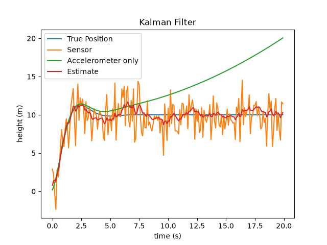
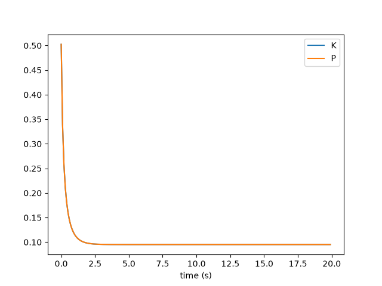

# kalman Filter — two-sensor fusion

A 1-D simulation that combines two unreliable sensors to figure out a drone's
height. Neither sensor is good enough on its own, but the combination of both
is better than both.

## Context

**Accelerometer.** Accurate short-term, but it has a small constant error that
gets integrated at every step, so the total error compounds as time passes and
the measurement drifts further and further off. After 20 seconds it is about
10 m wrong, and still getting worse.

**GPS.** It is jumpy and every reading is off by a couple of metres, in a random
direction. But the *size* of that error never grows. Reading 5000 is no worse
than reading 5.

## How it works

In my previous project (complementary-filter) I blended a prediction and a
measurement with a fixed, hand-tuned weight:

    estimate = a * prediction + (1 - a) * measurement     # a = 0.9, chosen by trial and error

The kalman filter is the same line. The only difference is that the weight is
computed every step instead of guessed once:

    K = P / (P + R)
    estimate = prediction + K * (measurement - prediction)
    P = (1 - K) * P

- **P** — how wrong I expect my estimate to be
- **R** — how wrong I expect the sensor to be
- **K** — the fraction of the move that goes to the sensor (similar to`1 - a`).

Each predict step grows P (`P = P + Q`) because coasting on the accelerometer
makes the estimate worse. Each update step shrinks P, because looking at the
GPS makes it better. K is the comparison between the two doubts.

The accelerometer basically drives the predict step and the GPS drives the update step.

Comparing it to project 3 settings, K settles at 0.095. I had tuned `a = 0.9` by hand, which is K = 0.1.

## Results

| source | RMSE vs truth |
|---|---|
| GPS | 1.92 m |
| Accelerometer | 4.53 m |
| **Fused estimate** | **0.56 m** |

The fused estimate is 3.5x better than GPS and 8x better than the
accelerometer. The 4.53 m flatters the accelerometer in a bad way. It is an average
over a run that was fine for the first five seconds and 10 m wrong at the end.

K starts at 0.217, falls to 0.146, and then stays flat:

Something I realized here is why K doesn't keep shifting toward GPS as the accelerometer
drifts. The answer is that the accelerometer never gets to drift, since it is corrected 
ten times a second, so it only ever has to be accurate for one step of 0.1 s, and over 
0.1 s it is excellent (since the accelerometer is especially good for short-term measurements).
The 10 m failure is what happens when it runs unchecked for 20 seconds. The filter basically 
regulates it and doesn't let it run for more than a tenth of one.

Settings: dt = 0.1 s, 200 steps (20 s), Q = 0.1, R = 4.0, GPS spread 2 m,
accelerometer bias 0.05 m/s².